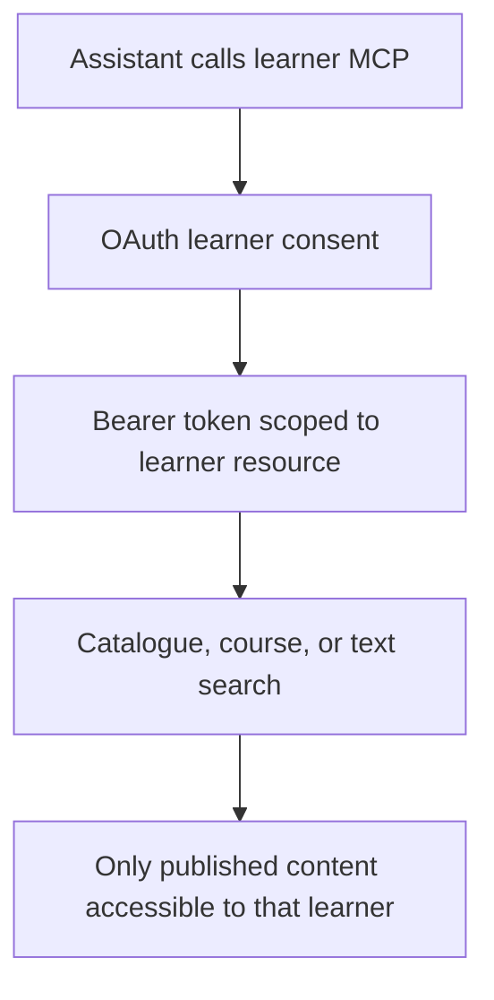
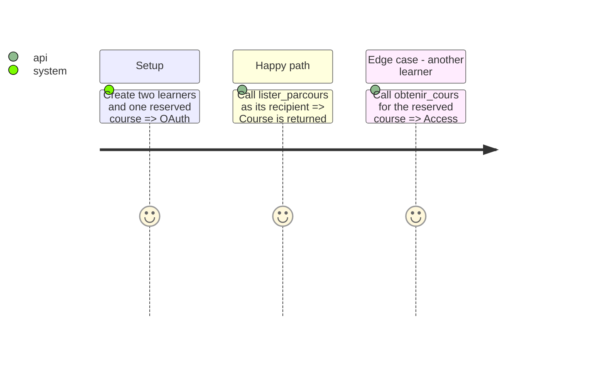

# Instruction: read-only learner MCP

## Architecture projection

```txt
✅ src/Mcp/LearnerMcpServer.php
✅ src/Controller/LearnerMcpController.php
✅ src/Security/LearnerConnectorUser.php
✅ src/Service/Learner/LearnerContentService.php
✏️ src/Service/OAuth/OAuthServer.php
✏️ src/Service/OAuth/PublicUrl.php
✏️ src/Controller/OAuthController.php
✏️ config/packages/security.yaml
✏️ OAuth entities and a new Doctrine migration
⏳ tests/Functional/Mcp/LearnerMcpTest.php
```

## User Journey



## Test Scope



## Tasks to do

### `1)` Separate OAuth resource and learner identity

1. Add resource and scope binding to OAuth grants.
2. Authorise a learner only for `/mcp/apprenant`.

### `2)` Expose safe learner read tools

1. Query published and accessible catalogue data directly.
2. Return source URLs and plain educational content.

### `3)` Assert isolation

1. Cover public, reserved, unpublished, and cross-learner cases.

## Test acceptance criteria

| Task | Acceptance criteria |
| --- | --- |
| 1 | An administration token cannot call the learner endpoint. |
| 2 | A learner sees public and own reserved content only. |
| 3 | Tests prove that another learner and unpublished content are excluded. |

## Delivery note

The implementation filters each course through `PageContent::isPublished()` and both the course and parcours access rules before returning it. Focused functional coverage remains pending.
