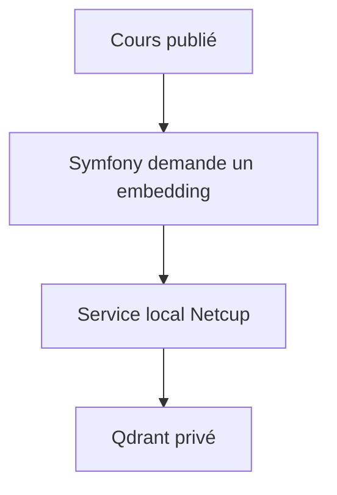
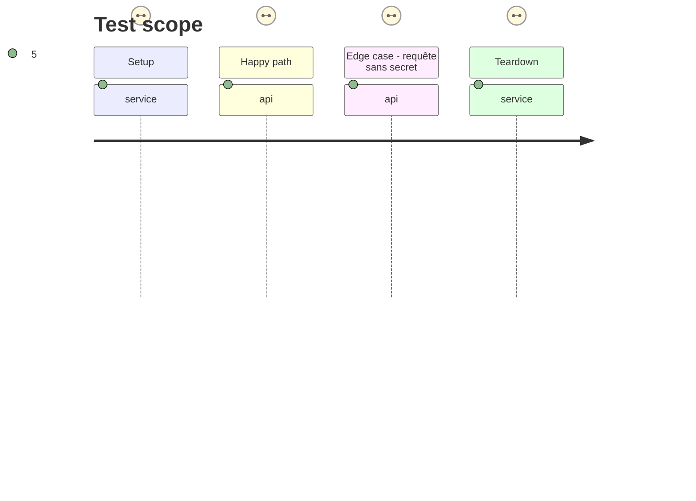

# Instruction: Service vectoriel privé sur Netcup

## Architecture projection

```txt
✅ deploy/netcup-rag/docker-compose.yml
✅ deploy/netcup-rag/.env.example
✅ deploy/netcup-rag/embedding/Dockerfile
✅ deploy/netcup-rag/embedding/app.py
✏️ docs/env.example
✏️ docs/HARNESS.md
```

## User Journey



## Test Scope



## Tasks to do

### `1)` Déployer les dépendances vectorielles privées

1. Ajouter une pile Docker Netcup, distincte du site OVH, avec Qdrant persistant et un service d'embeddings multilingue local.
2. Restreindre les endpoints aux appels authentifiés du site et du réseau Docker ; ne pas publier le tableau Qdrant.
3. Documenter variables, sauvegarde du volume, contrôle de santé et procédure de rotation des secrets.

## Test acceptance criteria

| Task | Acceptance criteria |
| --- | --- |
| 1 | Qdrant et le service d'embeddings répondent au contrôle de santé ; un appel non authentifié est refusé. |
