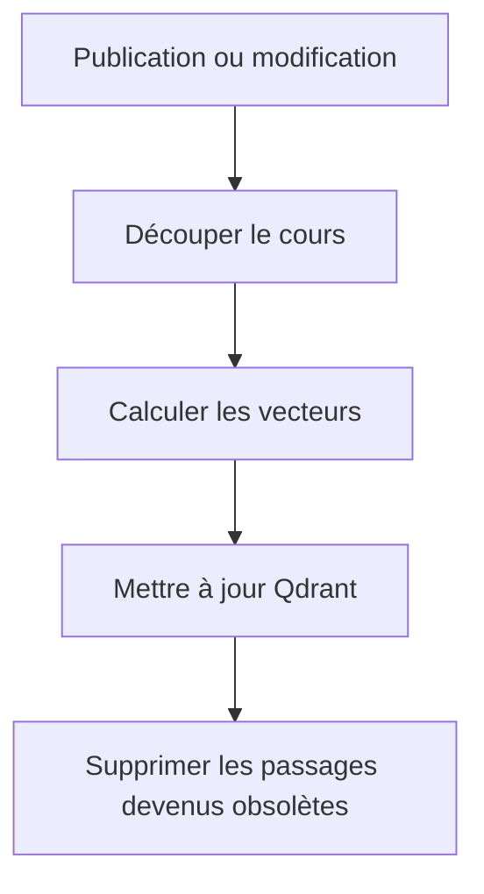
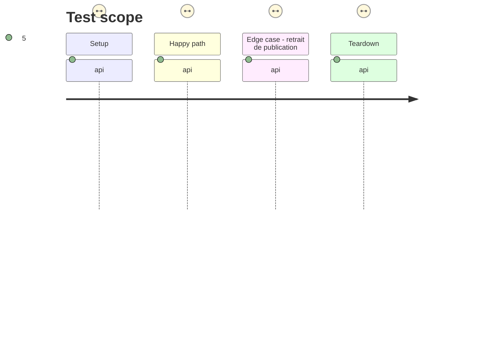

# Instruction: Indexation et recherche Symfony

## Architecture projection

```txt
✅ src/Service/Rag/VectorEmbeddingClient.php
✅ src/Service/Rag/VectorStore.php
✅ src/Command/ReindexVectorSearchCommand.php
✏️ src/Service/Rag/RagIndex.php
✏️ config/services.yaml
✏️ docs/env.example
✅ tests/Service/Rag/VectorStoreTest.php
```

## User Journey



## Test Scope



## Tasks to do

### `1)` Construire un index vectoriel synchronisable

1. Ajouter les clients HTTP Symfony pour embeddings et Qdrant, avec délais, erreurs lisibles et secrets uniquement dans l'environnement.
2. Réutiliser le découpage actuel, avec payload minimal : identifiant de cours, position, checksum et texte de citation.
3. Créer une commande de réindexation complète et synchroniser les créations, modifications, retraits de publication et suppressions.

### `2)` Conserver un repli contrôlé

1. Conserver MySQL FULLTEXT tant que la collection n'est pas complètement indexée.
2. Basculer vers le repli seulement en cas d'indisponibilité technique, sans masquer une erreur de droits.

## Test acceptance criteria

| Task | Acceptance criteria |
| --- | --- |
| 1 | Une modification remplace les vecteurs du cours et un retrait les efface. |
| 2 | Une panne vectorielle déclenche la recherche MySQL sans modifier les filtres d'accès. |
