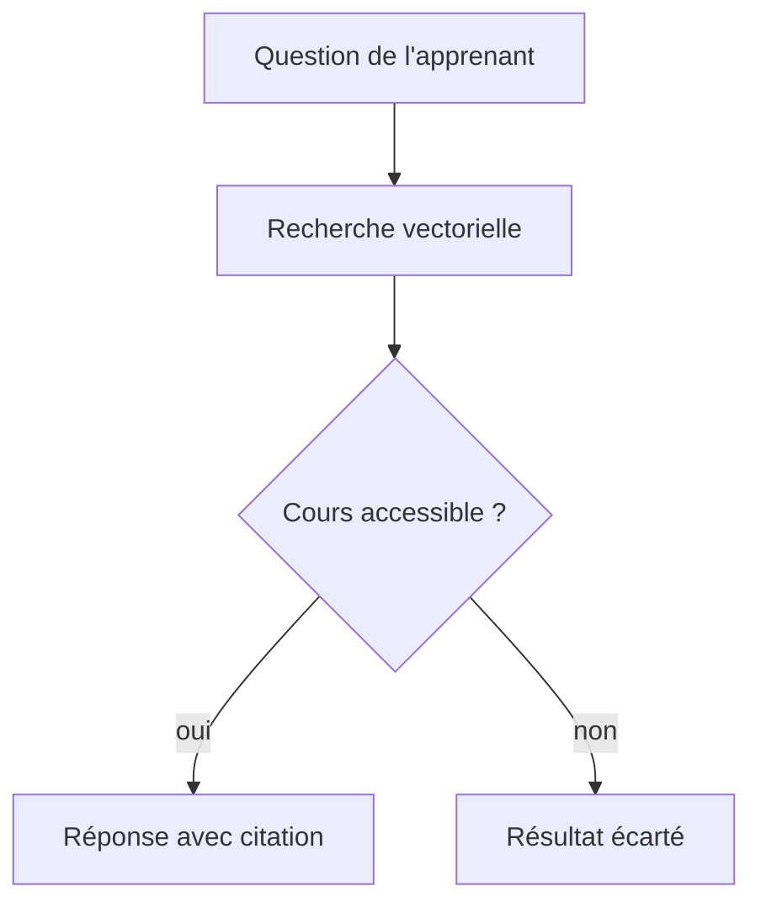
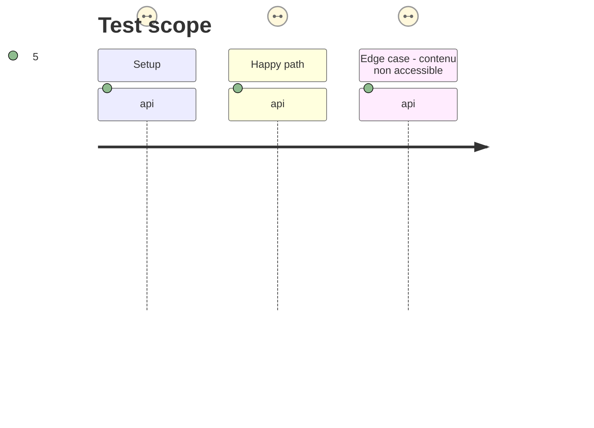

# Instruction: Recherche MCP citée et contrôlée

## Architecture projection

```txt
✏️ src/Service/Learner/LearnerContentService.php
✏️ src/Mcp/LearnerMcpServer.php
✅ tests/Functional/Mcp/LearnerVectorSearchTest.php
✏️ docs/CONNECTEUR.md
```

## User Journey



## Test Scope



## Tasks to do

### `1)` Rendre la recherche sémantique utile au MCP

1. Faire appeler la recherche vectorielle par `rechercher_cours`, avec un nombre de résultats borné et une citation traçable.
2. Contrôler à nouveau publication et accès après chaque résultat Qdrant.
3. Décrire clairement les limites : recherche documentaire, sources à vérifier, pas de réponse inventée.

## Test acceptance criteria

| Task | Acceptance criteria |
| --- | --- |
| 1 | Une requête sémantiquement proche retrouve le passage attendu avec titre, URL et position. |
| 1 | Un contenu brouillon ou attribué à un autre compte n'apparaît jamais, même s'il est dans l'index. |
