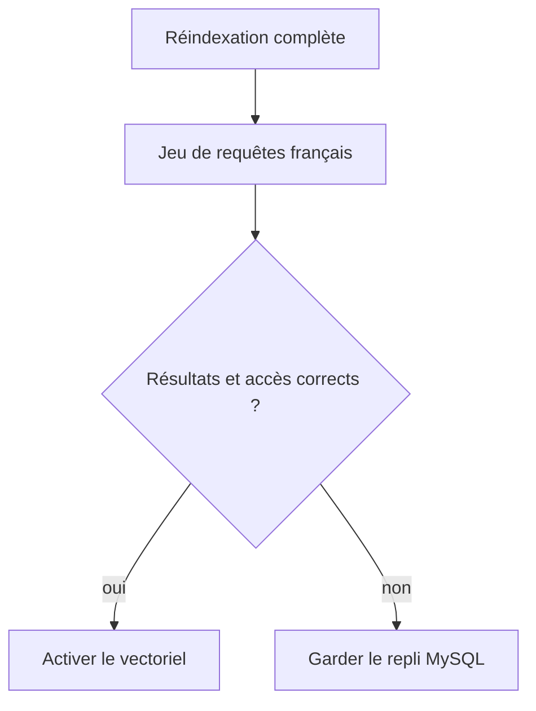
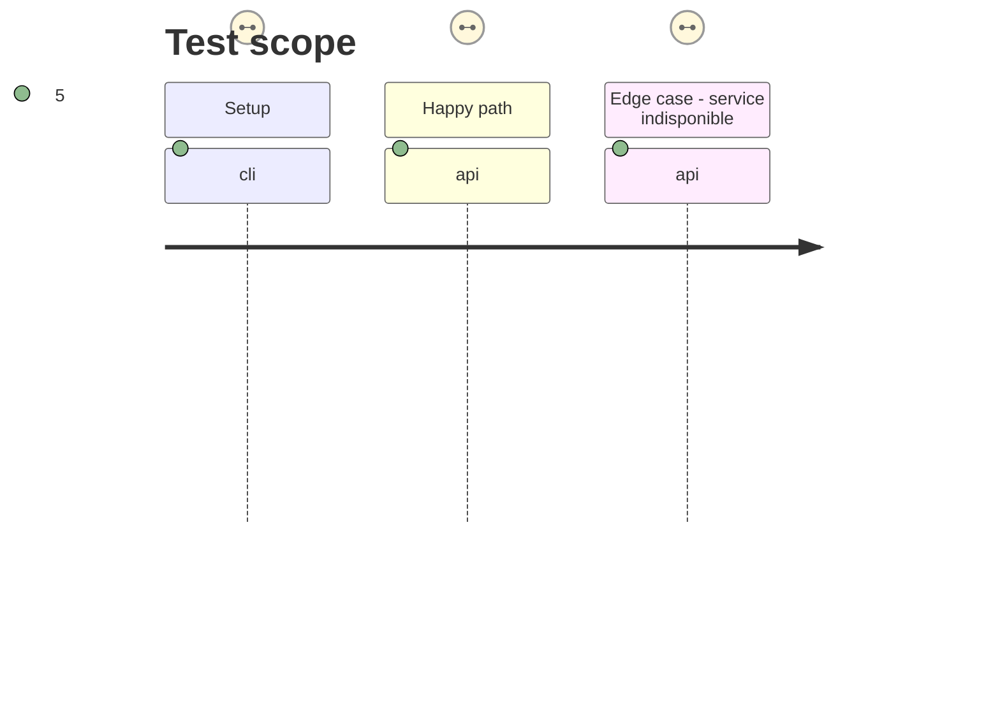

# Instruction: Bascule, mesures et exploitation

## Architecture projection

```txt
✏️ deploy/netcup-rag/docker-compose.yml
✏️ docs/HARNESS.md
✏️ docs/CONNECTEUR.md
✏️ PLAN_APP_FORMATION_IA.md
✅ docs/RAG_VECTORIEL.md
```

## User Journey



## Test Scope



## Tasks to do

### `1)` Valider et exploiter le nouveau moteur

1. Définir un jeu de requêtes françaises avec résultat attendu et contrôle d'absence de fuite de contenu réservé.
2. Documenter réindexation, sauvegarde/restauration Qdrant, alertes et retour temporaire à MySQL.
3. Activer le moteur vectoriel seulement après une recette sur données publiées et une vérification de production.

## Test acceptance criteria

| Task | Acceptance criteria |
| --- | --- |
| 1 | La recette prouve la pertinence minimale, les citations et l'absence de fuite entre apprenants. |
| 1 | L'exploitation permet de restaurer l'index ou d'utiliser le repli MySQL. |
